# Experimental Audit & First-Principles Research Framework (Antigravity Assessment)

**Document Type:** Design Document & Experimental Roadmap  
**Author:** Antigravity (Advanced AI Assistant)  
**Creation Date / Timestamp:** 2026-11-06T12:30:00+01:00  
**Context:** AGH University of Krakow — *Technologie Przemysłu 4.0* (Engineering Thesis / *Projekt Dyplomowy*)  
**Thesis Title:** *Rozpoznawanie znaków alfanumerycznych w trudnych warunkach środowiskowych z zastosowaniem konwolucyjnych sieci neuronowych*  
**Supervisor:** dr hab. inż. Adam Głowacz  

---

## 1. Executive Summary

This design document establishes a comprehensive research audit and experimental framework for an engineering diploma project addressing isolated 62-class alphanumeric character classification ($1 \times 32 \times 32$ grayscale crops) under environmental perturbations.

The framework consists of:
1. **Codebase & Artifact Audit:** Critical review of the existing Python research pipeline (`experiments/`) and completed Stage 1 experimental metrics.
2. **First-Principles Research Catalog:** 7 Scientific Pillars comprising 16 structured experiments designed independently of current progress to evaluate robustness, capacity, domain transfer, and edge efficiency.
3. **Comparative Analysis & Prioritized Action Roadmap:** 3 operational tiers balancing academic distinction with engineering feasibility.

---

## 2. Audit of Current Implementation & Baseline Artifacts

### 2.1 Repository Architecture & Implementation Assets
The experimental engine is structured modularly under `experiments/`:
- **Data Pipeline (`src/data/emnist.py`):** EMNIST ByClass (814,255 samples across 62 classes). Applies matrix transposition (`Image.Transpose.TRANSPOSE`) to correct NIST orientation quirks. Standardizes $28 \times 28$ glyphs into $32 \times 32$ tensors via 2-pixel black zero-padding (`fill=0`), preserving raw stroke edges without interpolation anti-aliasing blur. Standardizes intensities with empirical training statistics ($\mu = 0.1331, \sigma = 0.2870$).
- **Partition Integrity (`manifests/`):** Strict 90/10 training/validation split locked on disk as `train_indices.csv` (628,139 samples) and `val_indices.csv` (69,794 samples). Official test split (116,323 samples) is frozen.
- **Model Architecture (`src/models/cnn.py`):** `AlphanumericCNN` featuring 3 convolutional blocks ($1 \to 32 \to 64 \to 128$ channels, $3 \times 3$ kernels, BatchNorm2d, ReLU, $2 \times 2$ MaxPool2d) and a 256-unit dense classifier with BatchNorm1d and Dropout ($p = 0.5$).
  - **Parameter Count:** 634,110 trainable parameters (93,120 in feature extractor + 540,990 in dense classifier).
  - **Weight Footprint:** 2.42 MB (FP32 state dictionary); 7.28 MB full checkpoint with AdamW moments.
- **Degradation Simulator (`src/data/transforms.py`):** Continuous parametric implementations of Gaussian blur ($\sigma \in [0.0, 3.0]$), additive Gaussian sensor noise ($s \in [0.00, 0.20]$), and projective homography corner displacement ($p \in [0.00, 0.25]$).
- **Automated Sweep Harness (`src/experiments/degradation_sweep.py`):** Automated DataLoader batch evaluation across 19 discrete severity points (4,420,274 test inferences).
- **Dynamic Binding:** Outputs exported to `experiments/outputs/tables/accuracy_summary.json` and `practicality.json` for live import into the Typst document without hardcoded values.

### 2.2 Baseline Empirical Results (Stage 1 Ground Truth)
- **Model A (Clean Baseline, EXP-001):** Trained exclusively on pristine zero-padded samples. Overfit after Epoch 11 (validation loss rose from 0.3328 to 0.3549 by Epoch 25).
  - Clean Test Top-1 Accuracy: **87.62%**; Case-Insensitive Accuracy: **90.96%**; Macro-F1: **75.59%**.
  - Blur Breakdown: Collapsed below 50% at $\sigma \approx 1.25$; dropped to **4.28%** at $\sigma = 3.00$.
  - Noise Breakdown: Plunged past $s = 0.10$ to **37.65%** at $s = 0.20$.
  - Perspective Breakdown: Degraded linearly to **64.36%** at $p = 0.25$.
- **Model B (Robust CNN, EXP-002):** Trained with stochastic on-the-fly augmentations ($\sigma \le 2.0$, $s \le 0.15$, $p \le 0.25$, each $p=0.5$). Regularized training monotonically through Epoch 25 (validation loss 0.3326).
  - Clean Test Top-1 Accuracy: **87.46%** (-0.16 p.p. vs. baseline); Case-Insensitive Accuracy: **90.88%** (-0.08 p.p.); Macro-F1: **74.58%**; Macro-Precision: **82.07%** (+1.48 p.p.).
  - Blur Resilience: Sustained **86.20%** at $\sigma = 2.00$ (+73.96 p.p. over baseline); retained **64.44%** at out-of-distribution $\sigma = 3.00$ (+60.16 p.p. over baseline).
  - Noise Resilience: Flatline invariance across the range (**87.46% $\to$ 86.59%**, a drop of $<0.9$ p.p., +48.94 p.p. over baseline at $s = 0.20$).
  - Perspective Resilience: Degraded gracefully to **82.83%** (+18.47 p.p. over baseline at $p = 0.25$).
- **Cohen Homoglyph Ceiling:** Case-Insensitive evaluation unifying 15 visually indistinguishable pairs (`C/c`, `O/o`, `S/s`, `0/O`, `1/l/I`, etc.) recovered +3.34 p.p. (Model A) and +3.42 p.p. (Model B), proving ~3.4% error (~3,880 test samples) is an irreducible consequence of context-free isolated character cropping.
- **Hardware Latency / Throughput:**
  - CPU (Host): 1.08 ms / character (batch=1); 15.08 ms (batch=32, **2,122.6 chars/sec**).
  - GPU (NVIDIA T4/P100): 0.59 ms / character (batch=1); 0.69 ms (batch=32, **46,171.9 chars/sec**).

### 2.3 Identified Limitations in Current State
1. *Single Architecture:* No empirical comparison with historical (LeNet-5), lightweight modern (MobileNetV3-Small), or classical baselines (HOG + SVM).
2. *Single Seed:* All findings rely on `seed = 123`, leaving Research Question 4 unverified.
3. *Isolated Degradations:* Perturbations are evaluated in isolation, ignoring compound real-world conditions (glare, motion blur, contrast loss, uneven shadows).
4. *No Augmentation Ablation:* Model B was trained with all augmentations combined; cross-corruption generalization was not isolated.
5. *No Real-World / Cross-Domain Transfer:* No testing on natural fonts (Chars74k) or physical industrial camera captures.
6. *No Edge Deployment Quantization:* Lacks INT8 post-training quantization and ONNX Runtime benchmarks.
7. *No Visual Explainability:* Lacks saliency tracking (Grad-CAM) to prove feature-level mechanisms.

---

## 3. First-Principles Experimental Framework (7 Pillars / 16 Experiments)

### Pillar I: Industrial Degradation Taxonomy & Multi-Hazard Stress Testing
- **Exp 1.1: Extended Industrial Perturbations:** Implement 5 additional degradation modes: directional motion blur ($k \in [3, 15]$ px, $\theta \in [0^\circ, 180^\circ]$), illumination gradients ($\alpha + \beta \frac{x}{W}$), contrast reduction ($\gamma \in [1.0, 0.05]$), surface scratches/cutouts (5% to 35% area), and sensor downsampling ($16\times16$, $12\times12$, $8\times8$). Evaluate collapse profiles.
- **Exp 1.2: Compounded "Factory Floor" Multi-Hazard Benchmark:** Test simultaneous corruptions across 3 operational tiers: *Mild Industrial* (blur 0.8 + noise 0.04 + tilt 8% + contrast 0.85), *Moderate Industrial* (blur 1.5 + noise 0.08 + tilt 15% + motion blur 5px), and *Harsh Industrial* (blur 2.2 + noise 0.14 + tilt 22% + scratch 15%). Measures super-linear error compounding.

### Pillar II: Architectural & Paradigm Benchmarking
- **Exp 2.1: Micro-Backbone Spectrum:** Benchmark capacity vs. robustness across 4 models: (1) LeNet-5 (~60k params), (2) `AlphanumericCNN` (634k params), (3) MobileNetV3-Small adapted for $1 \times 32 \times 32$ (~900k params), (4) ShuffleNetV2 ($0.5\times$, ~350k params). Establish accuracy-latency Pareto frontier.
- **Exp 2.2: Classical Computer Vision Baseline (HOG + SVM):** Extract HOG descriptors (9 orientations, $4 \times 4$ cells) on 50,000 samples and train Linear/RBF SVM. Measure degradation vulnerability of handcrafted gradient histograms.
- **Exp 2.3: Off-the-Shelf OCR Engine Comparison (EasyOCR / Tesseract 5):** Run EasyOCR (recognition-only) and Tesseract (PSM 10) on 2,000 isolated character crops to quantify why general-purpose text-line engines fail on degraded single glyphs.

### Pillar III: Training Regimes & Augmentation Strategies
- **Exp 3.1: Systematic Single vs. Multi-Augmentation Ablation Matrix:** Train 5 models ($M_{\text{Clean}}$, $M_{\text{Blur}}$, $M_{\text{Noise}}$, $M_{\text{Persp}}$, $M_{\text{All}}$). Construct a $5 \times 3$ cross-corruption transfer matrix to measure whether single-corruption training provides cross-domain defense.
- **Exp 3.2: Domain-Specific vs. Generic Augmentations (Cutout / Mixup):** Compare degradation-aware training against standard regularization techniques (Cutout, Mixup) on blur and noise sweeps.
- **Exp 3.3: Curriculum Learning Scheduling:** Linearly scale augmentation severity over 25 epochs ($\sigma_{\max}(t) = \frac{t}{T} \sigma_{\text{target}}$) and evaluate convergence speed vs. static stochastic sampling.

### Pillar IV: Cross-Domain & Physical Transfer
- **Exp 4.1: Cross-Dataset Font & Scene Transfer (Chars74k):** Zero-shot evaluation of Model A and Model B on Chars74k-Fnt (digital fonts) and Chars74k-Img (natural scene crops) to test out-of-domain transfer.
- **Exp 4.2: Real-World Physical Industrial & Smartphone Captures:** Collect 50–100 crops of stamped/etched metal labels and carton packaging. Evaluate zero-shot transfer and quantify the Sim2Real gap.

### Pillar V: Model Compression, Quantization & Edge Deployment
- **Exp 5.1: Precision Scaling & INT8 Post-Training Quantization (PTQ):** Quantize `AlphanumericCNN` from FP32 to INT8 via static calibration. Measure accuracy retention, model compression ($2.42 \to 0.61$ MB), and edge feasibility.
- **Exp 5.2: Multi-Platform ONNX Runtime Benchmarking:** Benchmark PyTorch vs. ONNX Runtime across batch sizes ($b \in [1, 32]$) on host CPU and embedded ARM processor.

### Pillar VI: Explainability & Failure Diagnostics (XAI)
- **Exp 6.1: Grad-CAM Saliency Tracking Across Degradation Gradients:** Compute Grad-CAM heatmaps on `features[8]` across 5 severity steps of blur and noise for representative ambiguous glyphs ('A', '8', 'B', '0'). Visually demonstrate why Model B preserves stroke topology while Model A attention disperses.
- **Exp 6.2: Latent Representation Space Projections (t-SNE / UMAP):** Project 256-dimensional penultimate embeddings for 2,000 samples under clean and blurred conditions to visualize cluster separation.

### Pillar VII: Statistical Rigor & Repeatability
- **Exp 7.1: Multi-Seed Cross-Validation & Significance Testing:** Train Model A and Model B across 5 independent seeds (`[42, 123, 456, 789, 1024]`). Report mean $\pm$ standard deviation and paired Student's t-test $p$-values.
- **Exp 7.2: Class-Wise Imbalance & Per-Character Failure Dissection:** Dissect per-class accuracy and F1-scores as a function of sample frequency (Digits vs. Uppercase vs. Lowercase).

---

## 4. Prioritized Implementation Roadmap

```mermaid
flowchart LR
    subgraph T1["Tier 1: High Impact / Low Effort (1–2 Days)"]
        T1A["Exp 5.1 & 5.2: INT8 Quantization + ONNX Runtime Profiling"]
        T1B["Exp 6.1: Grad-CAM Saliency Visualizations"]
        T1C["Exp 1.2: Compounded 'Factory Floor' Multi-Hazard Test"]
        T1D["Exp 7.1: Multi-Seed Verification (N=3 Seeds)"]
    end
    subgraph T2["Tier 2: Substantive Depth (3–4 Days)"]
        T2A["Exp 4.2: Real-World Physical / Smartphone Crops"]
        T2B["Exp 4.1: Chars74k Cross-Dataset Transfer"]
        T2C["Exp 3.1: Single vs Multi-Augmentation Ablation Matrix"]
        T2D["Exp 2.1: Micro-Backbone Spectrum (MobileNetV3 vs LeNet)"]
    end
    subgraph T3["Tier 3: Exploratory Extensions"]
        T3A["Exp 2.3: EasyOCR / Tesseract Baseline Benchmark"]
        T3B["Exp 2.2: Classical HOG + SVM Baseline"]
        T3C["Exp 6.2: t-SNE Latent Feature Space Projections"]
    end
    T1 --> T2 --> T3
```

---

## 5. Architectural Invariants & Constraints

- **Scope Boundary:** Isolated single-character crop classification ($1 \times 32 \times 32$), not full-page text line detection.
- **Statistical Integrity:** All reported metrics must include explicit percentage point indicators, decimal commas in Polish text, and seed uncertainty bounds.
- **Zero Hardcoding:** All tables and plots in Typst must bind dynamically to machine-readable JSON/CSV artifacts.
