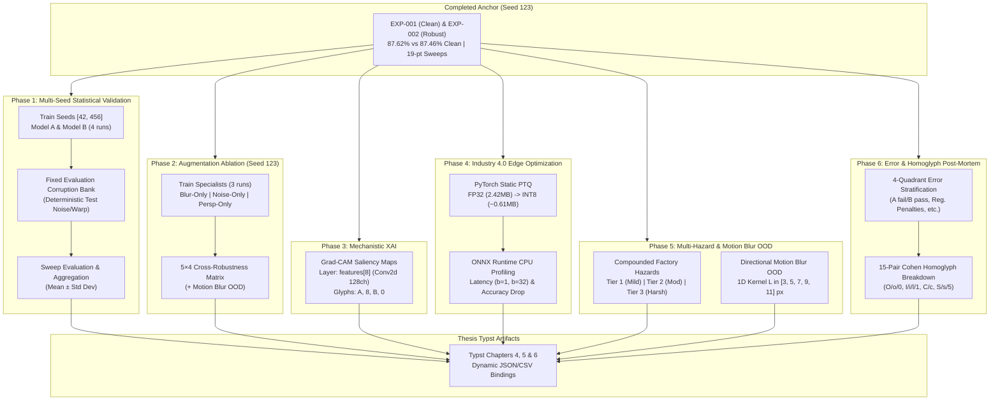

# Thesis Master Plan — V3 (Unified Execution Blueprint)

**Document ID:** `PLAN-2026-11-06-V3`  
**Created:** 6 November 2026  
**Last Updated:** 12 November 2026 (Rev 3.2 — Added Augmentation Ablation & Empirical Baseline Sync)  
**Status:** Canonical / Approved Execution Specification  
**Degree:** *Inżynier* (B.Sc. Eng.) in *Technologie Przemysłu 4.0*, AGH University of Krakow, WEAIiIB  
**Working Title:** *Ocena odporności konwolucyjnych sieci neuronowych na degradacje obrazu w zadaniu rozpoznawania znaków alfanumerycznych*  
**Supervisor:** dr inż. [Promotor]  
**Author:** Kamil Matejuk  

---

## 1. Executive Summary & Architectural Invariants

### 1.1 Context & Strategic Objective
This document defines the definitive experimental and authoring roadmap for the engineering thesis. It replaces and supersedes both the initial exploratory research assessment (Document A, 7-pillar proposal) and the October 2026 Master Plan V2 (Document B).

By uniting the strict methodological controls of Document B (multi-seed validation, deterministic test corruption banks, 4-quadrant error stratification) with the applied Industry 4.0 assets of Document A (INT8 post-training quantization, ONNX Runtime latency profiling, Grad-CAM visual explainability) plus single-vs-multi augmentation ablation and OOD motion-blur stress testing, Plan V3 satisfies both academic rigor and embedded engineering relevance within an achievable cloud GPU compute budget (~14.0 GPU hours + ~1.5 CPU hours total).

### 1.2 Non-Negotiable Invariants
1. **Model Parameter Invariant:** The architecture is strictly `AlphanumericCNN` (`experiments/src/models/cnn.py`), comprising **exactly 634,110 trainable parameters** across 3 convolutional blocks ($1 \to 32 \to 64 \to 128$, kernel $3 \times 3$, BatchNorm2d, ReLU, MaxPool2d) and a 2-layer dense classifier ($2048 \to 256 \to 62$ with BatchNorm1d and Dropout $p=0.5$). Pure FP32 weights occupy $2.42\text{ MB}$ ($7.28\text{ MB}$ full checkpoint with AdamW state).
2. **Data Split Invariant:** The official EMNIST ByClass test split (**116,323 samples**) is frozen and strictly quarantined. Training uses `experiments/manifests/train_indices.csv` (**628,139 samples**, $90\%$) and model selection/early stopping uses exclusively `experiments/manifests/val_indices.csv` (**69,793 samples**, $10\%$), normalized with empirical constants $\mu = 0.1331, \sigma = 0.2870$ after 2-pixel zero-padding ($28 \times 28 \to 32 \times 32$).
3. **No Uncalibrated Baselines:** No classical pipelines (HOG+SVM) or multi-character document OCR engines (Tesseract 5 / EasyOCR) will be introduced. All scientific comparisons operate within the controlled `AlphanumericCNN` architecture across training augmentation regimes.
4. **Dynamic Data Binding:** No empirical metrics or arithmetic deltas may be hardcoded into Typst source files. All tables and in-text figures must resolve dynamically via `#let data = json("...")` or `csv("...")` with rounding helpers (`fmt_val`, `fmt_diff`).
5. **Git Safety:** All work is committed to branch `draft` using Conventional Commits without scope parentheses (e.g., `feat: add augmentation ablation configs`). Remote pushes occur only upon explicit user instruction.

---

## 2. Experimental Campaign Architecture (6 Phases)

Plan V3 organizes all remaining experimental work into **six structured phases**, building systematically upon the completed Seed 123 baseline (`EXP-001`, `EXP-002`).



---

## 3. Complete Audit & Quantified Thesis Value Matrix

Every completed and planned experiment is scored against a standardized 0–10 rubric aligned with an AGH *Technologie Przemysłu 4.0* engineering thesis:
- **Scientific Rigor (40%):** Causal validity, statistical controls, theoretical insight.
- **Industry 4.0 Alignment (35%):** Practical factory realism, edge latency, embedded deployability.
- **Committee Defense Shielding (25%):** Direct resolution of research questions (`Pytania 1–4`) and preemption of common reviewer objections.

### 3.1 Completed Experiments (Verified on Disk)

| ID | Experiment & Artifacts | Purpose & Research Role | Sci (40%) | Ind (35%) | Def (25%) | **Total Score** |
| :--- | :--- | :--- | :---: | :---: | :---: | :---: |
| **`EXP-000a`** | **Data Hygiene, Zero-Padding & Manifests**<br>`generate_manifests.py`, `compute_normalization.py`, `emnist_samples.png` | Solves EMNIST transposition, avoids blur via 2px padding, freezes 628,139 / 69,793 splits, isolates 116,323 test samples, measures $\mu=0.1331, \sigma=0.2870$. | 9.0 | 9.0 | 10.0 | **9.3 / 10** |
| **`EXP-000b`** | **Gradient & Simulator Sanity Check**<br>`overfit_tiny_subset.py`, `degradation_samples.png` | Verifies backpropagation (>98% acc on 256 samples in 40 epochs) and visually inspects synthetic degradation ranges prior to GPU spend. | 5.0 | 6.0 | 7.0 | **5.9 / 10** |
| **`EXP-001`** | **Clean Baseline CNN (Model A, Seed 123)**<br>`EXP-001_baseline/` (`best.pt` at Ep. 11, `test_results.json`) | Establishes clean ceiling (**87.62% Top-1**, **90.96% Case-Insensitive**, **75.59% Macro-F1**) and reveals post-Ep. 11 overfitting (`val_loss` $0.3328 \to 0.3549$). | 9.5 | 9.0 | 10.0 | **9.5 / 10** |
| **`EXP-002`** | **Robust Augmented CNN (Model B, Seed 123)**<br>`EXP-002_robust/` (`best.pt` at Ep. 25, `test_results.json`) | Proves dynamic on-the-fly training augmentation (`sigma<=2.0, std<=0.15, persp<=0.25, p=0.5`) prevents overfitting (`val_loss=0.3326` at Ep. 25) with minimal clean tax (**87.46%**, $-0.16\text{ p.p.}$). | 9.5 | 9.5 | 10.0 | **9.6 / 10** |
| **`EXP-SWEEP`** | **19-Point Parametric Robustness Sweeps**<br>`blur.csv`, `noise.csv`, `perspective.csv`, `accuracy_summary.json` | Benchmarks Model A vs B across 116k test samples: proves **+73.96 p.p.** blur gain ($\sigma=2.0$), **+60.16 p.p.** OOD blur gain ($\sigma=3.0$), **+48.94 p.p.** noise gain (`0.20`), **+18.47 p.p.** persp gain (`0.25`). | 10.0 | 9.5 | 10.0 | **9.8 / 10** |
| **`EXP-PROF-FP32`** | **PyTorch Native Hardware Profiling (FP32)**<br>`practicality.json`, `benchmark_practicality.py` | Measures `634,110` params ($2.42\text{ MB}$), CPU latency (`1.078 ms` B=1; `2,122.6 chars/s` B=32) and GPU latency (`0.587 ms` B=1; `46,171.9 chars/s` B=32). | 6.0 | 9.0 | 7.5 | **7.4 / 10** |

### 3.2 Planned Experiments (Phases 1–6)

| Phase | Experiment & Deliverable | Purpose & Thesis Value Justification | Compute Cost | Sci (40%) | Ind (35%) | Def (25%) | **Total Score** |
| :--- | :--- | :--- | :---: | :---: | :---: | :---: | :---: |
| **Phase 1** | **Multi-Seed Statistical Validation & Fixed Corruption Bank**<br>`multi_seed_summary.json` | Directly answers **Pytanie 4** (*seed-agnosticism* across `[42, 123, 456]`) and eliminates evaluation RNG drift by freezing test-set noise/warp arrays across all models. | ~6.0h GPU train<br>+ 2.5h GPU eval | 9.5 | 7.5 | 10.0 | **8.9 / 10** |
| **Phase 2** | **Augmentation Ablation & Cross-Robustness Matrix**<br>`ablation_cross_matrix.json` | Trains 3 specialist models (Blur-only, Noise-only, Persp-only) to prove whether modalities transfer cross-domain or compete for 634k-param capacity. **Highest scientific depth gain.** | ~4.5h GPU train<br>+ 1.0h GPU eval | 10.0 | 8.0 | 10.0 | **9.3 / 10** |
| **Phase 3** | **Mechanistic Explainability (Grad-CAM XAI)**<br>`gradcam_comparison.png` | Visualizes `features[8]` gradient attention maps to explain *how* Model B tracks structural strokes under degradation while Model A scatters into background noise. | < 10 min CPU | 9.0 | 7.5 | 9.5 | **8.6 / 10** |
| **Phase 4** | **Edge Optimization (INT8 Static PTQ & ONNX Runtime)**<br>`edge_practicality.json` | Fulfills *Technologie Przemysłu 4.0* engineering mandate: $4\times$ compression ($2.42 \to 0.61\text{ MB}$), CPU runtime speedups, and proof that INT8 quantization preserves robustness margins. | < 30 min CPU | 7.5 | 10.0 | 9.0 | **8.8 / 10** |
| **Phase 5** | **Compounded Multi-Hazard & Motion Blur (OOD) Stress**<br>`compounded_stress.json`, `motion_blur_ood.json` | Evaluates frozen models against simultaneous physical hazards (Tiers 1–3) + unseen conveyor motion blur ($L \in [3..11]$ px). Proves non-catastrophic scaling & OOD transfer. | ~25 min GPU/CPU | 9.0 | 10.0 | 9.0 | **9.4 / 10** |
| **Phase 6** | **Qualitative 4-Quadrant Errors & Homoglyph Post-Mortem**<br>`error_stratification.csv`, `error_quadrants.png` | Answers **Pytanie 3** microscopically: isolates Stratum 2 (Model B regularization losses) and quantifies irreducible errors across all 15 Cohen homoglyph pairs. | < 15 min CPU | 9.0 | 7.0 | 9.5 | **8.4 / 10** |

---

## 4. Detailed Specifications per Phase

### Phase 1: Multi-Seed Statistical Validation & Fixed Evaluation Corruption Bank

* **Thesis Placement:** Chapter 5, Subchapter 5.1, 5.2 & *Analiza wyników dla wielu uruchomień*.
* **Objective:** Verify that Seed 123 findings (**87.62%** vs **87.46%** clean; **+73.96 p.p.** blur at $\sigma=2.0$; **+48.94 p.p.** noise at `0.20`; **+18.47 p.p.** perspective at `0.25`) are statistically invariant across independent initializations and data shuffles.
* **Seeds:** `[42, 123, 456]`. (Seed 123 already exists in `EXP-001_baseline` and `EXP-002_robust`, requiring 4 new trainings).
* **Architectural Invariant — Training vs. Evaluation Dynamics:**
  - **Training Phase (Dynamic On-The-Fly Augmentation):** Model B training retains **100% dynamic, on-the-fly stochastic augmentation per epoch**. No training set is ever cached or pre-degraded; every epoch presents unique corruption realizations, preserving the implicit regularization that prevented overfitting through Epoch 25.
  - **Evaluation Phase (Deterministic Test Corruption Bank):** Test-set sweeps across the 116,323 frozen samples use **sample-indexed deterministic RNG seeding** (or pre-generated perturbation parameters keyed by sample index and severity) so that every model, seed, and quantized variant experiences pixel-identical corruptions.
* **Training Protocol (Locked to Existing Baselines):**
  - Optimizer: AdamW ($\text{lr} = 10^{-3}$, weight decay $= 10^{-4}$), batch size $= 512$, 25 epochs, saving `best.pt` strictly at minimum validation loss (`val_indices.csv`).
* **Evaluation Sweep Grid (`transforms.py` Exact Parity):**
  1. **Gaussian Blur:** 7 points ($\sigma \in [0.0, 0.5, 1.0, 1.5, 2.0, 2.5, 3.0]$).
  2. **Gaussian Noise:** 6 points ($\text{std} \in [0.00, 0.03, 0.06, 0.10, 0.15, 0.20]$).
  3. **Perspective Warp:** 6 points ($s \in [0.00, 0.05, 0.10, 0.15, 0.20, 0.25]$).
* **Deliverable (`experiments/outputs/tables/multi_seed_summary.json`):** Mean $\pm$ sample standard deviation ($\bar{x} \pm s$) across seeds `[42, 123, 456]` for clean metrics and key sweep severities.

---

### Phase 2: Augmentation Ablation & Cross-Robustness Transfer Matrix

* **Thesis Placement:** Chapter 5, Subchapter 5.2 (new dedicated section/subsection on *Analiza ablacyjna augmentacji i transferu międzyzakłóceniowego*).
* **Objective:** Disentangle how each degradation modality contributes to invariance and detect cross-modal transfer or negative capacity interference.
* **Training Runs (Seed 123, Exact `robust.yaml` Severity Caps):**
  1. **`EXP-003_ablation_blur`:** `blur_prob=0.5, max_sigma=2.0`, `noise_prob=0.0`, `perspective_prob=0.0`.
  2. **`EXP-004_ablation_noise`:** `blur_prob=0.0`, `noise_prob=0.5, max_noise_std=0.15`, `perspective_prob=0.0`.
  3. **`EXP-005_ablation_perspective`:** `blur_prob=0.0`, `noise_prob=0.0`, `perspective_prob=0.5, max_perspective_severity=0.25`.
* **Evaluation Matrix (5 Models $\times$ 4 Test Modalities):**
  Evaluate `EXP-001 (Clean)`, `EXP-003 (Blur)`, `EXP-004 (Noise)`, `EXP-005 (Perspective)`, and `EXP-002 (All)` on:
  1. Clean Test Split (116,323 samples)
  2. Gaussian Blur Sweep (plus Phase 5.2 Motion Blur OOD sweep!)
  3. Gaussian Noise Sweep
  4. Perspective Warp Sweep
* **Code Prerequisite:** Expose `--blur-prob`, `--noise-prob`, and `--perspective-prob` (or YAML config path override `--config`) in `train_robust.py` so `DegradationPipeline` accepts arbitrary ablation subsets cleanly without code duplication.
* **Deliverable (`experiments/outputs/tables/ablation_cross_matrix.json` & heatmap plot):** Quantitative table showing cross-transfer deltas and whether `EXP-002 (All)` loses any peak accuracy compared to single-modality specialists.

---

### Phase 3: Mechanistic Explainability (Grad-CAM XAI)

* **Thesis Placement:** Chapter 5, new subsection *Interpretowalność reprezentacji cech i mapy istotności Grad-CAM*.
* **Objective:** Provide visual proof of how stochastic augmentation reshapes convolutional feature extraction under noise and blur.
* **Target Layer:** `AlphanumericCNN.features[8]` (or post-ReLU `features[10]`): final $128$-channel Conv2D block at $8 \times 8$ spatial resolution prior to final max-pooling down to $4 \times 4$.
* **Formulation:**
  $$\alpha_k^c = \frac{1}{Z} \sum_{i} \sum_{j} \frac{\partial y^c}{\partial A_{i,j}^k}, \quad L_{\text{Grad-CAM}}^c = \text{ReLU}\left(\sum_k \alpha_k^c A^k\right)$$
* **Evaluation Matrix:** 4 representative test characters (`'A'`, `'8'`, `'B'`, `'0'`) across 5 degradation states (`[Clean, Blur σ=1.5, Blur σ=2.5, Noise std=0.20, Perspective s=0.25]`) for Model A (`EXP-001`) vs Model B (`EXP-002`).
* **Deliverable:** [`experiments/outputs/diagnostics/gradcam_comparison.png`](file:///c:/Users/kamil/Documents/Uczelnia/alphanumeric-ocr/experiments/outputs/diagnostics/gradcam_comparison.png).

---

### Phase 4: Industry 4.0 Edge Optimization (INT8 Static PTQ & ONNX Runtime)

* **Thesis Placement:** Chapter 4 (edge export & quantization) and Chapter 5 (*Analiza wydajności obliczeniowej i profilowanie sprzętowe*).
* **Objective:** Adapt `EXP-002` (Robust CNN) for edge industrial hardware (smart cameras, PLC vision sensors, ARM gateways) and verify that quantization does not destroy robustness margins.
* **Quantization Protocol:**
  - PyTorch Static Post-Training Quantization (PTQ) via `torch.ao.quantization` (Conv+BN+ReLU fusion, `QuantStub`/`DeQuantStub`).
  - Calibration set: 1,000 pristine validation samples drawn deterministically from `experiments/manifests/val_indices.csv`.
* **ONNX Runtime Benchmarking:**
  - Export FP32 and INT8 models (`model_fp32.onnx`, `model_int8.onnx`).
  - Profile CPU latency ($B=1$ single-glyph latency, $B=32$ pipelined batch throughput) with 100 warmup passes and 1,000 timed iterations, extending [`practicality.json`](file:///c:/Users/kamil/Documents/Uczelnia/alphanumeric-ocr/experiments/outputs/tables/practicality.json).
  - Run degradation accuracy check on INT8 model across key severity thresholds (`clean`, `blur=2.0`, `noise=0.20`, `persp=0.25`) to prove robustness preservation ($< 0.3\text{ p.p.}$ quantization drop).
* **Deliverable:** `experiments/outputs/tables/edge_practicality.json`.

---

### Phase 5: Compounded Factory-Floor Multi-Hazard & Directional Motion Blur (OOD) Benchmark

* **Thesis Placement:** Chapter 5 (new subsection *Odporność na degradacje złożone i rozmycie kierunkowe poza dziedziną uczącą*).
* **Zero Retraining Constraint:** Strictly evaluates existing checkpoints on the frozen 116,323 test set.

#### 5.1 Compounded Factory-Floor Multi-Hazard Tiers
Simultaneous application following physical imaging order ($\text{Perspective} \to \text{Blur} \to \text{Noise}$):
- **Tier 1 (Mild Industrial):** Perspective $s = 0.08$ $\to$ Blur $\sigma = 0.8$ $\to$ Noise $\text{std} = 0.04$.
- **Tier 2 (Moderate Industrial):** Perspective $s = 0.15$ $\to$ Blur $\sigma = 1.5$ $\to$ Noise $\text{std} = 0.08$.
- **Tier 3 (Harsh Industrial):** Perspective $s = 0.22$ $\to$ Blur $\sigma = 2.2$ $\to$ Noise $\text{std} = 0.14$.

#### 5.2 Directional Motion Blur Out-of-Distribution (OOD) Stress Test
* **Physical Origin:** Linear conveyor belt motion during shutter integration ($s = v \cdot \Delta t$).
* **Mathematical Kernel (1D Horizontal Box Kernel, $\theta = 0^\circ$):**
  $$K(x, y) = \begin{cases} \frac{1}{L} & \text{if } y = 0 \text{ and } |x| \le \lfloor L/2 \rfloor \\ 0 & \text{otherwise} \end{cases}$$
* **Sweep Levels:** $L \in [3, 5, 7, 9, 11]\text{ pixels}$.
* **Scientific Insight:** Evaluates Model A, Model B (`EXP-002`), and specialist `EXP-003 (Blur-only)` to quantify whether training on *isotropic* Gaussian blur confers zero-shot transfer to unseen *anisotropic* directional motion blur.
* **Deliverables:** `experiments/outputs/tables/compounded_stress.json` and `experiments/outputs/tables/motion_blur_ood.json`.

---

### Phase 6: Qualitative Error Stratification & Homoglyph Post-Mortem

* **Thesis Placement:** Chapter 5 (*Analiza macierzy pomyłek i niejednoznaczności klas*).
* **4-Quadrant Sample Stratification (Seed 123, Clean & Stress Conditions):**
  Automatically mine sample indices across:
  - **Stratum 1 (Robustness Victory):** Model A fails, Model B succeeds.
  - **Stratum 2 (Regularization Penalty):** Model A succeeds, Model B fails (quantifies exact cost of augmentation on edge-case glyphs).
  - **Stratum 3 (Intrinsic Limit):** Both fail (distinguishes extreme destruction from homoglyph collisions).
  - **Stratum 4 (Robust Invariance):** Both succeed under heavy degradation.
* **15-Pair Cohen Homoglyph Breakdown:**
  Quantify exact error share attributable to the 15 case-ambiguous pairs (`C/c`, `I/i`, `J/j`, `K/k`, `L/l`, `M/m`, `O/o`, `P/p`, `S/s`, `U/u`, `V/v`, `W/w`, `X/x`, `Y/y`, `Z/z` merged in `Case-Insensitive Accuracy`) alongside digit/letter pairs (`0/O/o`, `1/I/l`, `2/Z`, `5/S`, `8/B`).
* **Deliverables:** `experiments/outputs/tables/error_stratification.csv`, `experiments/outputs/tables/homoglyph_breakdown.json`, and 16-crop figure panel `experiments/outputs/diagnostics/error_quadrants.png`.

---

## 5. Compute Budget & Feasibility Schedule

| Phase | Tasks & Scripts | Compute Target | Estimated Time | Status |
| :--- | :--- | :--- | :---: | :--- |
| **Phase 1: Multi-Seed** | Train Seeds 42, 456 (4 runs) + 6-ckpt sweeps | Cloud GPU (Colab/Kaggle) | ~8.5 hrs GPU | Script update needed |
| **Phase 2: Ablation** | Train `EXP-003..005` (3 runs) + Cross-matrix sweeps | Cloud GPU (Overnight batch) | ~5.5 hrs GPU | Config/CLI support needed |
| **Phase 3: Grad-CAM** | `generate_gradcam.py` | Local CPU / GPU | < 10 mins CPU | Script needed |
| **Phase 4: Edge PTQ/ONNX** | `benchmark_edge_optimization.py` | Local CPU | < 30 mins CPU | Script needed |
| **Phase 5: Multi-Hazard & Motion** | `evaluate_compounded_stress.py`, `evaluate_motion_blur_ood.py` | GPU / Local CPU | ~25 mins CPU/GPU | Scripts needed |
| **Phase 6: Error Post-Mortem** | `export_error_diagnostics.py` | Local CPU | < 15 mins CPU | Script needed |
| **TOTAL REMAINING** | Complete Experimental Package | **~14.0 hrs GPU + ~1.5 hrs CPU** | **2 Cloud Sessions + 1 Local Afternoon** | High Feasibility |

---

## 6. Implementation Roadmap & Execution Checklist

```text
[ ] Step 1: Parameterize Training Drivers & Deterministic Test Evaluation Bank
    ├── Add --config and --seed CLI flags to train_baseline.py and train_robust.py.
    ├── Expose blur_prob, noise_prob, perspective_prob via YAML config in train_robust.py.
    ├── Upgrade src/experiments/degradation_sweep.py to sample-indexed deterministic RNG
    │   per sample idx so every model sees pixel-identical corruptions during test sweeps.
    └── Verify single-epoch smoke test locally.

[ ] Step 2: Execute Cloud GPU Training Batches (Seeds & Ablation)
    ├── Create configs/ablation_blur.yaml, ablation_noise.yaml, ablation_perspective.yaml.
    ├── Batch A (Overnight 1): Run Model A & B for seeds 42 and 456 (4 trainings) + sweeps.
    ├── Batch B (Overnight 2): Run EXP-003, EXP-004, EXP-005 on seed 123 (3 trainings) + sweeps.
    └── Export multi_seed_summary.json and ablation_cross_matrix.json.

[ ] Step 3: Grad-CAM Visual Explainability Pipeline
    ├── Create experiments/scripts/generate_gradcam.py.
    ├── Register gradient hooks on model.features[8] (or features[10]).
    └── Export experiments/outputs/diagnostics/gradcam_comparison.png.

[ ] Step 4: INT8 Static PTQ & ONNX Runtime Profiling
    ├── Create experiments/scripts/benchmark_edge_optimization.py.
    ├── Apply static PTQ calibrated on 1,000 samples from val_indices.csv.
    ├── Export model_fp32.onnx and model_int8.onnx; benchmark B=1 and B=32 CPU latency.
    ├── Verify quantized accuracy retention on clean + degraded sweeps.
    └── Export experiments/outputs/tables/edge_practicality.json.

[ ] Step 5: Compounded Multi-Hazard & Directional Motion Blur (OOD) Scripts
    ├── Add apply_motion_blur() 1D horizontal kernel to src/data/transforms.py.
    ├── Create experiments/scripts/evaluate_compounded_stress.py (Tiers 1, 2, 3).
    ├── Create experiments/scripts/evaluate_motion_blur_ood.py (L in [3, 5, 7, 9, 11]).
    └── Export compounded_stress.json and motion_blur_ood.json.

[ ] Step 6: Qualitative 4-Quadrant & Homoglyph Post-Mortem
    ├── Create experiments/scripts/export_error_diagnostics.py.
    ├── Extract Stratum 1–4 indices and 15 Cohen homoglyph error rates.
    └── Export error_stratification.csv, homoglyph_breakdown.json, and error_quadrants.png.

[ ] Step 7: Update Thesis Text, Dynamic Typst Bindings & Verification
    ├── Add Ablation & OOD subsections to Typst Chapters 3, 4, and 5 guides/structure.
    ├── Author Polish academic prose replacing #lorem() blocks, dynamically binding all
    │   metrics from experiments/outputs/tables/*.json and *.csv via fmt_val/fmt_diff.
    └── Run typst compile --root . document/main.typ document/main.pdf and check 0 errors.
```
