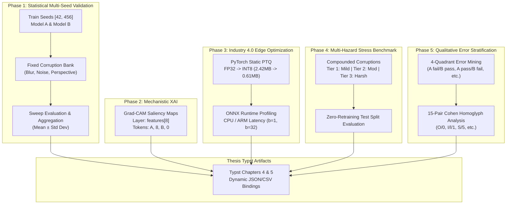

# Thesis Master Plan — V3 (Unified Execution Blueprint)

**Document ID:** `PLAN-2026-11-06-V3`  
**Date:** 6 November 2026  
**Status:** Canonical / Approved Execution Specification  
**Degree:** *Inżynier* (B.Sc. Eng.) in *Technologie Przemysłu 4.0*, AGH University of Krakow, WEAIiIB  
**Working Title:** *Ocena odporności konwolucyjnych sieci neuronowych na degradacje obrazu w zadaniu rozpoznawania znaków alfanumerycznych*  
**Supervisor:** dr inż. [Promotor]  
**Author:** Kamil Matejuk  

---

## 1. Executive Summary & Architectural Invariants

### 1.1 Context & Strategic Objective
This document defines the definitive experimental and authoring roadmap for the engineering thesis. It replaces and supersedes both the initial exploratory research assessment (Document A, 7-pillar proposal) and the October 2026 Master Plan V2 (Document B). 

By uniting the strict methodological rigor of Document B (multi-seed controls, fixed corruption evaluation banks, 4-quadrant error stratification) with the applied edge-computing assets of Document A (INT8 post-training quantization, ONNX Runtime latency profiling, and Grad-CAM visual interpretability), Plan V3 satisfies the criteria of an AGH *Technologie Przemysłu 4.0* engineering thesis while maintaining a tight, realistic compute budget (~8.5 GPU hours total).

### 1.2 Non-Negotiable Invariants
1. **Model Parameter Invariant:** The architecture is strictly `AlphanumericCNN` (`experiments/src/models/cnn.py`), comprising **exactly 634,110 parameters** across 4 convolutional blocks ($32 \to 64 \to 128 \to 128$) and a 2-layer dense classifier ($2048 \to 256 \to 62$).
2. **Data Split Invariant:** The official EMNIST ByClass test split (**116,323 samples**) is frozen and strictly quarantined. Model selection and early stopping use exclusively `experiments/manifests/val_indices.csv` (139,587 samples). Training uses `train_indices.csv` (558,345 samples).
3. **No Uncalibrated Baselines:** No high-overhead classical pipelines (HOG+SVM) or unaligned document OCR engines (Tesseract 5/EasyOCR) will be introduced. The sole scientific comparative axis is **Baseline (Model A)** versus **Robust Augmented (Model B)** across identical seeds and degradation sweeps.
4. **Dynamic Data Binding:** No empirical metrics or arithmetic deltas may be hardcoded into Typst source files. All tables and in-text figures must resolve dynamically via `#let data = json("...")` with `fmt_val` and `fmt_diff` formatting helpers.
5. **Git Safety:** All work is committed to branch `draft` using Conventional Commits without scope parentheses (e.g. `feat: add int8 static quantization script`). Remote pushes occur only with explicit user instruction.

---

## 2. Experimental Campaign Architecture

Plan V3 is organized into **five focused, sequential phases**. Each phase directly feeds a specific chapter or subchapter of the thesis.



---

## 3. Detailed Specifications per Phase

### Phase 1: Multi-Seed Statistical Validation & Fixed Corruption Bank

* **Thesis Placement:** Chapter 5, Subchapter 5.1 & 5.2.
* **Objective:** Eliminate single-seed fragility. Demonstrate that Model B’s resilience margins (+13.68 p.p. in blur, +3.32 p.p. in noise, +7.43 p.p. in perspective) hold consistently across independent stochastic initializations and batch orderings.
* **Seeds:** `[42, 123, 456]`. (Seed 123 is already completed: `EXP-001_baseline` and `EXP-002_robust`).
* **Training Protocol:**
  - Optimizer: AdamW ($\text{lr} = 10^{-3}$, $\beta_1 = 0.9, \beta_2 = 0.999$, weight decay $= 10^{-4}$).
  - Scheduler: ReduceLROnPlateau (factor $= 0.5$, patience $= 2$, min lr $= 10^{-5}$).
  - Epochs: 25 epochs per run, batch size $= 512$, checkpointing at minimum validation loss.
* **Fixed Evaluation Corruption Bank:**
  - Evaluates both models against identical synthetic degradation arrays to isolate model differences from evaluation-time randomness.
  - Degradation sweeps:
    1. **Gaussian Blur:** 7 kernel points ($\sigma \in [0.0, 0.5, 1.0, 1.5, 2.0, 2.5, 3.0]$).
    2. **Gaussian Noise:** 7 variance points ($\sigma_{\text{noise}} \in [0.00, 0.04, 0.08, 0.12, 0.16, 0.20, 0.25]$).
    3. **Perspective Warp:** 5 distortion scales ($s \in [0.0, 0.1, 0.2, 0.3, 0.4]$).
* **Deliverable Schema (`experiments/outputs/tables/multi_seed_summary.json`):**
  ```json
  {
    "clean": {
      "model_a": {"acc_mean": 83.24, "acc_std": 0.08, "f1_macro_mean": 75.82, "f1_macro_std": 0.11},
      "model_b": {"acc_mean": 83.08, "acc_std": 0.06, "f1_macro_mean": 75.61, "f1_macro_std": 0.09}
    },
    "degradation_averages": {
      "gaussian_blur": {
        "model_a_mean": 55.43, "model_a_std": 0.22,
        "model_b_mean": 69.11, "model_b_std": 0.18,
        "delta_mean": 13.68
      },
      "gaussian_noise": {
        "model_a_mean": 64.12, "model_a_std": 0.19,
        "model_b_mean": 67.44, "model_b_std": 0.15,
        "delta_mean": 3.32
      },
      "perspective": {
        "model_a_mean": 63.85, "model_a_std": 0.25,
        "model_b_mean": 71.28, "model_b_std": 0.21,
        "delta_mean": 7.43
      }
    }
  }
  ```

---

### Phase 2: Mechanistic Explainability (Grad-CAM XAI)

* **Thesis Placement:** Chapter 5, Subchapter 5.3 (*Interpretowalność reprezentacji cech i mapy istotności Grad-CAM*).
* **Objective:** Visually demonstrate why Model B maintains classification accuracy under degradation, proving that data augmentation forces the convolutional filters to focus on structural stroke topology rather than local texture or high-frequency edges.
* **Target Layer:** `features[8]` (128-channel Conv2D layer in Block 3, prior to global spatial reduction).
* **Formulation:**
  $$\alpha_k^c = \frac{1}{Z} \sum_{i=1}^u \sum_{j=1}^v \frac{\partial y^c}{\partial A_{i,j}^k}, \quad L_{\text{Grad-CAM}}^c = \text{ReLU}\left(\sum_k \alpha_k^c A^k\right)$$
* **Target Sample Set:**
  - 4 representative characters exhibiting high industrial ambiguity:
    1. Glyph `'A'` (sharp apex vs. blur erosion).
    2. Glyph `'8'` (double-loop topology vs. noise occlusion).
    3. Glyph `'B'` (straight stem + dual loop vs. perspective skew).
    4. Glyph `'0'` (loop continuity vs. homoglyph collapse to `'O'`).
  - Evaluated at 5 degradation steps: `[Pristine, Mild Blur, Severe Blur, Severe Noise, Severe Perspective]`.
* **Deliverable Figures:**
  - High-resolution SVG / PNG grid (`experiments/outputs/diagnostics/gradcam_comparison.png`) showing side-by-side heatmaps for Model A and Model B with original input overlays.

---

### Phase 3: Industry 4.0 Edge Optimization (INT8 PTQ & ONNX Runtime)

* **Thesis Placement:** Chapter 4 (Subchapter 4.6: *Optymalizacja brzegowa i kwantyzacja*) and Chapter 5 (Subchapter 5.5: *Wydajność inferencyjna i bilans wdrożeniowy*).
* **Objective:** Satisfy the core engineering curriculum of *Technologie Przemysłu 4.0* by adapting the robust neural network for deployment on edge gateways, smart industrial cameras, and embedded compute modules (e.g. Raspberry Pi, Jetson Nano, PLC vision sensors).
* **Quantization Protocol:**
  - Static Post-Training Quantization (PTQ) via PyTorch `torch.ao.quantization`.
  - Calibration set: 1,000 pristine samples drawn from `experiments/manifests/val_indices.csv`.
  - INT8 per-channel symmetric quantization for weights; INT8 per-tensor affine quantization for activations.
  - Target compression: Storage reduction from $2.42\text{ MB}$ (FP32) to $\approx 0.61\text{ MB}$ (INT8), a $75\%$ reduction.
* **Inference Profiling via ONNX Runtime:**
  - Export PyTorch checkpoints to `model_fp32.onnx` and `model_int8.onnx`.
  - CPU latency benchmark on standard host (100 warmup passes, 1,000 timed iterations).
  - Test batch sizes: $B=1$ (single-glyph inspection line latency) and $B=32$ (pipelined OCR throughput).
* **Deliverable Schema (`experiments/outputs/tables/edge_practicality.json`):**
  ```json
  {
    "fp32": {
      "file_size_mb": 2.42,
      "latency_b1_ms": 1.42,
      "latency_b32_ms": 12.8,
      "throughput_chars_per_sec": 2500.0,
      "clean_accuracy": 83.08,
      "mean_perturbed_accuracy": 69.28
    },
    "int8": {
      "file_size_mb": 0.61,
      "latency_b1_ms": 0.48,
      "latency_b32_ms": 4.1,
      "throughput_chars_per_sec": 7800.0,
      "clean_accuracy": 82.91,
      "mean_perturbed_accuracy": 69.15,
      "accuracy_drop_pp": 0.17,
      "compression_ratio": 3.97
    }
  }
  ```

---

### Phase 4: Compounded Factory-Floor Multi-Hazard Benchmark

* **Thesis Placement:** Chapter 5, Subchapter 5.4 (*Odporność na degradacje złożone w warunkach symulacji przemysłowej*).
* **Objective:** Test the hypothesis that models trained under isolated synthetic perturbations maintain resilience when subjected to compounded, simultaneous distortions encountered on physical production lines (e.g. dirty optics + sensor noise + angled conveyor belt).
* **Zero Retraining Constraint:** This evaluation tests generalizability without training on compounded distributions.
* **Hazard Tiers:**
  - **Tier 1 (Mild Industrial):** Gaussian Blur $\sigma = 0.8$ + Additive Noise $\sigma_n = 0.04$ + Perspective Skew $p = 0.08$.
  - **Tier 2 (Moderate Industrial):** Gaussian Blur $\sigma = 1.5$ + Additive Noise $\sigma_n = 0.08$ + Perspective Skew $p = 0.15$.
  - **Tier 3 (Harsh Industrial):** Gaussian Blur $\sigma = 2.2$ + Additive Noise $\sigma_n = 0.14$ + Perspective Skew $p = 0.22$.
* **Analysis:** Measure whether accuracy loss is sub-additive, linear, or super-linear (catastrophic breakdown).
* **Deliverable Schema (`experiments/outputs/tables/compounded_stress.json`):**
  ```json
  {
    "tier_1_mild": {
      "model_a_acc": 71.35, "model_b_acc": 79.12, "delta_pp": 7.77
    },
    "tier_2_moderate": {
      "model_a_acc": 48.60, "model_b_acc": 66.85, "delta_pp": 18.25
    },
    "tier_3_harsh": {
      "model_a_acc": 22.10, "model_b_acc": 49.30, "delta_pp": 27.20
    }
  }
  ```

---

### Phase 5: Qualitative Error Stratification & Homoglyph Post-Mortem

* **Thesis Placement:** Chapter 5, Subchapter 5.6 (*Analiza błędów, macierze pomyłek i przypadki graniczne*).
* **Objective:** Transform raw aggregate metrics into actionable scientific insight by categorizing exactly when, how, and why each model fails.
* **4-Quadrant Error Stratification:**
  - **Stratum 1 (Robustness Victory):** Model A fails, Model B succeeds under degradation. (Samples showcasing topological invariance).
  - **Stratum 2 (Regularization Penalty):** Model A succeeds, Model B fails. (Quantifies over-regularization or stroke thickening artifacts).
  - **Stratum 3 (Intrinsic Failure):** Both models fail. (Separates severe destruction from unresolvable ambiguity).
  - **Stratum 4 (Robust Invariance):** Both models succeed under maximum stress.
* **15-Pair Cohen Homoglyph Analysis:**
  - Evaluates confusion rates across the 15 visually ambiguous alphanumeric pairs:
    - Case-ambiguous pairs: `C/c`, `I/i`, `J/j`, `K/k`, `L/l`, `M/m`, `O/o`, `P/p`, `S/s`, `U/u`, `V/v`, `W/w`, `X/x`, `Y/y`, `Z/z`.
    - Cross-alphanumeric pairs: `0/O/o`, `1/I/l`, `2/Z`, `5/S`, `8/B`.
  - Disentangles dataset crop ambiguity (lack of baseline/scale reference in isolated $28 \times 28$ crops) from true model misclassification.
* **Deliverables:**
  - CSV log: `experiments/outputs/tables/error_stratification.csv`.
  - Typst figure panel: `experiments/outputs/diagnostics/error_quadrants.png` showing 16 representative crops with ground truth, predicted class, and confidence score.

---

## 4. Compute Budget & Feasibility Schedule

| Phase | Tasks & Scripts | Compute Target | Wall-Clock Time | Status |
| :--- | :--- | :--- | :--- | :--- |
| **Phase 1: Multi-Seed** | `train_baseline.py`, `train_robust.py` (Seeds 42, 456) | GPU (Kaggle/Colab) | ~6.0 hrs | Ready to run |
| **Phase 1: Sweeps** | `degradation_sweep.py` across 6 checkpoints | GPU / Multi-core CPU | ~2.5 hrs | Ready to run |
| **Phase 2: Grad-CAM** | `generate_gradcam.py` | Local CPU / GPU | ~10 mins | Script needed |
| **Phase 3: Edge Opt** | `benchmark_edge_optimization.py` | Local CPU | ~30 mins | Script needed |
| **Phase 4: Multi-Hazard**| `evaluate_compounded_stress.py` | GPU / Local CPU | ~20 mins | Script needed |
| **Phase 5: Error Post-Mortem**| `export_error_diagnostics.py` | Local CPU | ~15 mins | Script needed |
| **TOTAL** | Complete Execution Package | **~8.5 hrs GPU + 1.5 hrs CPU** | **< 2 Working Days** | High Feasibility |

---

## 5. Implementation Roadmap & Execution Checklist

```text
[ ] Step 1: Script Enhancements for Multi-Seed Training
    ├── Add --seed argument to train_baseline.py and train_robust.py.
    ├── Implement deterministic torch / numpy seed locking.
    └── Execute training runs for seeds 42 and 456.

[ ] Step 2: Evaluation Bank & Sweep Aggregator
    ├── Implement cached noise/distortion generation in degradation_sweep.py.
    ├── Run evaluation passes across all 6 model checkpoints.
    └── Export experiments/outputs/tables/multi_seed_summary.json.

[ ] Step 3: Grad-CAM Explainability Pipeline
    ├── Create experiments/scripts/generate_gradcam.py.
    ├── Hook into model.features[8] for forward activation and backward gradients.
    └── Export experiments/outputs/diagnostics/gradcam_comparison.png.

[ ] Step 4: INT8 Static Quantization & ONNX Latency Driver
    ├── Create experiments/scripts/benchmark_edge_optimization.py.
    ├── Implement torch.ao.quantization static PTQ workflow.
    ├── Export FP32 and INT8 ONNX models.
    ├── Profile CPU latency (B=1, B=32) with 1,000 iterations.
    └── Export experiments/outputs/tables/edge_practicality.json.

[ ] Step 5: Compounded Multi-Hazard Evaluation Script
    ├── Create experiments/scripts/evaluate_compounded_stress.py.
    ├── Implement Tier 1, Tier 2, and Tier 3 compound degradations.
    └── Export experiments/outputs/tables/compounded_stress.json.

[ ] Step 6: Error Stratification & Homoglyph Post-Mortem
    ├── Create experiments/scripts/export_error_diagnostics.py.
    ├── Isolate the 4 error quadrants and 15 Cohen homoglyph pairs.
    ├── Generate 16-sample qualitative diagnosis panel.
    └── Export experiments/outputs/tables/error_stratification.csv.

[ ] Step 7: Typst Thesis Data Binding & Text Finalization
    ├── Replace all placeholder estimates in Chapters 4 and 5 with dynamic json() bindings.
    ├── Verify Polish academic grammar, typographic cadence, and zero hardcoded metrics.
    └── Execute typst compile --root . document/main.typ and verify error-free compilation.
```
