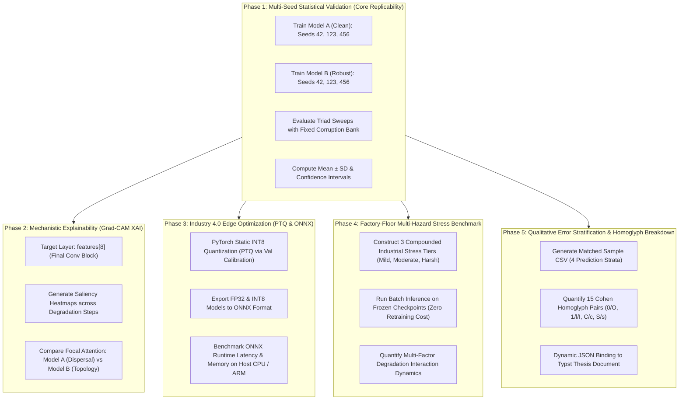

# Comparative Design Review & Synthesis Blueprint: Unified Thesis Plan V3

**Document Purpose:** Formal comparative design evaluation and unified operational blueprint for the AGH engineering thesis (*projekt dyplomowy*).  
**Context:** AGH University of Krakow, Faculty of Electrical Engineering, Automatics, Computer Science and Biomedical Engineering (WEAIiIB), Department of Automatics and Robotics (*Katedra Automatyki i Robotyki*).  
**Degree Course:** *Technologie Przemysłu 4.0* (Industry 4.0 Technologies).  
**Thesis Title:** *Rozpoznawanie znaków alfanumerycznych w trudnych warunkach środowiskowych z zastosowaniem konwolucyjnych sieci neuronowych*  
**Author:** Kamil Sebastian Suhak | **Supervisor:** dr hab. inż. Adam Głowacz  
**Documents Evaluated:**
1. `docs/plans/2026-11-06_antigravity_experimental_assessment.md` (Document A - Antigravity)
2. `docs/plans/2026-10-11_thesis_master_plan_v2.md` (Document B - Master Plan V2)

---

## 1. Context & Degree Alignment: "Technologie Przemysłu 4.0"

An engineering thesis (*praca inżynierska*) in *Technologie Przemysłu 4.0* must satisfy two interrelated academic criteria:
1. **Scientific Rigor:** Sound experimental design, reproducible statistical baselines, disciplined data isolation, and controlled perturbation mechanics.
2. **Industrial & Applied Viability:** Explicit grounding in automated industrial environments (production lines, machine vision inspection, edge smart sensors, embedded computing constraints).

A purely academic machine-learning study that ignores edge constraints fails the applied criteria of an Industry 4.0 engineering title. Conversely, a purely descriptive software engineering project (e.g., wrapping an existing model in a web interface) lacks scientific and methodological depth. 

The evaluation of Documents A and B hinges directly on this intersection: balancing methodological precision with practical industrial edge relevance.

---

## 2. Critical Audit of Document A (Antigravity Assessment)

`docs/plans/2026-11-06_antigravity_experimental_assessment.md`

### 2.1 Over-Engineering & Scope Explosion (Blocker Risk)
Document A specifies **7 Scientific Pillars** containing **16 discrete experiments**. When analyzed from a first-principles compute and execution perspective, this architecture collapses under its own weight:

* **Combinatorial Training Explosion:** EMNIST ByClass contains 628,139 training samples. A standard 25-epoch run requires $15,703,475$ sample passes. 
  - Exp 7.1 proposes 5 seeds across models ($2 \times 5 = 10$ full runs).
  - Exp 3.1 proposes a 5-model single-versus-multi ablation matrix ($M_{\text{Clean}}, M_{\text{Blur}}, M_{\text{Noise}}, M_{\text{Persp}}, M_{\text{All}}$) across seeds ($5 \times 3 = 15$ runs).
  - Exp 2.1 proposes training 3 additional architectures (LeNet-5, MobileNetV3-Small, ShuffleNetV2) across seeds ($3 \times 3 = 9$ runs).
  - Total training passes: $\approx 34 \times 15.7 \times 10^6 \approx 5.3 \times 10^8$ inferences, or approximately **80–100 GPU hours** on Kaggle/Colab infrastructure. Free-tier GPU allocations (typically capped at 30 hours/week with preemption risk) cannot support this volume without severe operational failure.
* **Classical CV Strawman (Exp 2.2 - HOG + SVM):** Handcrafted HOG features coupled with an SVM classifier scaled to 62 classes and 50,000 samples introduce quadratic optimization bottlenecks with zero neural network relevance. The thesis title specifically mandates *konwolucyjne sieci neuronowe* (CNNs). Benchmarking against an unoptimized SVM is a generic academic trope that yields predictably inferior performance while consuming substantial implementation overhead.
* **Off-the-Shelf Engine Mismatch (Exp 2.3 - EasyOCR / Tesseract 5):** Running full-page OCR engines (designed for text-line segmentation, baseline regression, and language-model post-correction) on tightly cropped $1 \times 32 \times 32$ isolated characters in PSM 10 mode is fundamentally flawed. Tesseract and EasyOCR frequently fail to detect bounding boxes or reject single character crops outright. Measuring their error rates against a forced-choice 62-way CNN classifier introduces an apples-to-oranges confound.
* **Curriculum Learning Hyperparameter Risk (Exp 3.3):** Proposing dynamic linear augmentation severity scheduling ($\sigma_{\max}(t) = \frac{t}{T} \sigma_{\text{target}}$) introduces uncalibrated pacing variables. Stochastic uniform augmentation already regularizes training effectively (validation loss improved monotonically through epoch 25). Adding unproven training dynamics risks destabilizing convergence without clear theoretical necessity.
* **Uninterpretable Dimensionality Reduction (Exp 6.2 - t-SNE / UMAP):** Projecting 256-dimensional embeddings for 62 classes into a 2D plane invariably creates an indistinct, cluttered cluster cloud. Visual separation across 62 handwriting classes—especially uppercase/lowercase pairs—cannot be resolved in 2D and provides negligible diagnostic signal compared to a confusion matrix.

### 2.2 High-Value Contributions to Preserve
Despite the scope bloat, Document A correctly identifies four foundational technical gaps in the current implementation:
1. **INT8 Post-Training Quantization (Exp 5.1):** Compressing weights from FP32 ($2.42\text{ MB}$) to INT8 ($\approx 0.61\text{ MB}$) directly demonstrates edge deployment capability on low-cost microcontrollers.
2. **ONNX Runtime Multi-Platform Profiling (Exp 5.2):** Validates execution speed and memory footprints across standard CPU and embedded ARM environments, bridging the gap between theoretical modeling and Industry 4.0 smart vision sensors.
3. **Grad-CAM Saliency Tracking (Exp 6.1):** Computes class-activation gradients on the final convolutional layer (`features[8]`). This transforms subjective claims ("the robust model learns structural topology") into verifiable, visual heatmaps showing whether activations remain centered on stroke junctions or disperse into background noise.
4. **Compounded Multi-Hazard Benchmarking (Exp 1.2):** Industrial camera environments do not experience single-parameter Gaussian perturbations in isolation. Testing simultaneous compound corruptions (e.g., blur + noise + angle skew) on *frozen models* incurs zero retraining cost while offering significant real-world validity.

---

## 3. Critical Audit of Document B (Master Plan V2)

`docs/plans/2026-10-11_thesis_master_plan_v2.md`

### 3.1 Defensive Blind Spots & Under-Delivery Risks (Major Gaps)
Document B is exceptionally disciplined, but its conservatism introduces major vulnerabilities:

* **Premature Parking of ONNX & Embedded Deployment (§1, §4.3):** Document B explicitly parks ONNX conversion, edge deployment, and hardware profiling as "software engineering fluff" outside the core research direction. For a Computer Science or Pure Mathematics degree, this might be defensible. For an engineering degree in **Technologie Przemysłu 4.0 at AGH WEAIiIB**, this is a critical blind spot. Industry 4.0 is fundamentally defined by cyber-physical systems, edge processing, and hardware integration. Eliminating all deployment benchmarking leaves the project as a detached dataset study.
* **Rejection of Visual Explainability (XAI):** Document B relies exclusively on aggregate scalar tables, confusion matrices, and sample prediction grids. While sample prediction grids are useful, they fail to answer *why* the internal representation breaks down. Without saliency heatmaps (Grad-CAM), the thesis lacks mechanistic insight into feature extractor behavior under severe distribution shifts.
* **Risk of Under-Delivering on Technical Novelty:** Milestone 1 (September 2026) has already trained Model A and Model B, executed the 4.4M-pass degradation sweeps, and computed clean test metrics. If Document B's plan is strictly adhered to, the remaining work is reduced to:
  - Running 2 additional seeds.
  - Generating an error CSV.
  - Writing the Typst chapters.
  This minimal extension leaves the candidate open to severe criticism during defense for coasting on Milestone 1 results without advancing technical depth.

### 3.2 Methodological Rigor & Strengths to Retain
Document B contains crucial scientific safeguards that must be preserved:
1. **Separation of Stochastic Sources (§6.1):** Document B draws a critical distinction:
   - *Training-Seed Variation:* Tests whether the conclusion survives re-initialization and batch shuffling across independent training runs.
   - *Evaluation-Corruption Variation:* Tests whether the conclusion survives different random draws of noise or perspective grids on the test set.
   Document B correctly dictates using a fixed, matched corruption bank across models so Model A and Model B are evaluated on bit-identical degraded pixels.
2. **Qualitative Error Stratification (§7.2):** Mandates structured 4-quadrant case analysis:
   - Stratum 1: Model A incorrect / Model B correct (demonstrating robustness gain).
   - Stratum 2: Model A correct / Model B incorrect (identifying regularization penalty / edge-case failure).
   - Stratum 3: Both incorrect (isolating intrinsic class ambiguity or extreme corruption limits).
   - Stratum 4: Both correct despite severe corruption (demonstrating structural invariants).
3. **Academic Writing Discipline & Anti-Hype (§10):** Enforces precise scientific phrasing: explicit percentage point notation (`p.p.`), elimination of promotional AI buzzwords (*"rewolucyjny"*, *"uniwersalne panaceum"*), and avoiding unsubstantiated assertions (e.g., refraining from calling the 91% case-insensitive metric an "unbreakable theoretical ceiling").
4. **Ruthless Scope Boundaries (§1, §4.3):** Firmly excludes web apps, cloud REST APIs, and full-page text detection pipelines that dilute core experimental focus.

---

## 4. Head-to-Head Comparative Matrix

| Evaluation Dimension | Document A (Antigravity Assessment) | Document B (Thesis Master Plan V2) | Unified Synthesis Blueprint (V3) | Rationale & Trade-Off Resolution |
| :--- | :--- | :--- | :--- | :--- |
| **Compute & Training Feasibility** | **Critical Risk:** 16 experiments, ~34 training runs (>80 GPU hrs). | **High:** 2 models $\times$ 3 seeds (6 runs, ~10 GPU hrs). | **High:** 2 models $\times$ 3 seeds (6 runs total). | Prevents GPU timeout; focuses resources on statistically robust core models. |
| **Industry 4.0 Relevance** | **High:** Includes INT8 PTQ, ONNX profiling, and edge metrics. | **Deficient:** Parks all ONNX, deployment, and optimization work. | **High:** Integrates INT8 PTQ and ONNX Runtime CPU/ARM latency benchmarks. | Restores degree-mandated industrial edge computing context. |
| **Mechanistic Explainability (XAI)** | **High:** Grad-CAM across degradation sweeps + t-SNE. | **Deficient:** Relies solely on scalar tables and error tables. | **Targeted:** Grad-CAM saliency tracking on final conv layer; t-SNE removed. | Provides visual evidence of filter invariance without messy 62-class 2D projection. |
| **Degradation Realism** | **Broad:** Extended corruptions (motion blur, lighting, compound). | **Controlled:** Focuses on the core triad (blur, noise, perspective). | **Optimized:** Core triad + zero-retraining Compounded Multi-Hazard Benchmark. | Compound evaluation tests factory-floor conditions with zero added training compute. |
| **Baseline Comparisons** | **Bloated:** LeNet, MobileNet, ShuffleNet, HOG+SVM, EasyOCR. | **Minimal:** Model A vs. Model B only. | **Clean Causal:** Model A vs. Model B + Cohen homoglyph baseline. | Isolates the exact causal impact of degradation-aware data augmentation. |
| **Statistical Integrity** | Proposes 5 seeds, paired t-tests (high compute). | Separates training seed vs evaluation seed; 3 seeds. | 3 training seeds ($N=3$) + fixed evaluation corruption bank. | Balances statistical variance bounds with realistic execution limits. |
| **Error Diagnostics** | Aggregate class-wise imbalance analysis. | Structured 4-quadrant qualitative error panel + CSV export. | Structured 4-quadrant qualitative error panel + ambiguity matrix. | Guarantees transparent reporting of both model strengths and failure modes. |

---

## 5. Synthesis Blueprint: Unified Master Thesis Plan (V3)

The Unified Plan (V3) combines Document B’s methodological discipline with Document A’s high-value Industry 4.0 edge engineering and explainability assets.

### 5.1 Architecture & Fixed Invariants
* **Input Representation:** $1 \times 32 \times 32$ grayscale image tensor (2px black zero-padded from $28 \times 28$ EMNIST glyphs, preserving raw stroke geometry). Standardized via $\mu = 0.1331, \sigma = 0.2870$.
* **Network Topology (`AlphanumericCNN`):**
  - Feature Extractor: 3 Conv blocks ($1 \to 32 \to 64 \to 128$, $3 \times 3$ kernels, padding 1, BatchNorm2d, ReLU, $2 \times 2$ MaxPool).
  - Classifier Head: Flatten ($2048$) $\to$ Linear ($2048 \to 256$) $\to$ BatchNorm1d $\to$ ReLU $\to$ Dropout ($p=0.5$) $\to$ Linear ($256 \to 62$).
  - Total Parameters: 634,110 (all trainable; 2.42 MB FP32 weights).
* **Data Splits:**
  - Frozen EMNIST ByClass Test Set: $n = 116,323$ samples.
  - Training / Validation Splits: Persistent manifests on disk (`train_indices.csv`: 628,139; `val_indices.csv`: 69,794).

---

### 5.2 Phased Experimental Architecture



---

### 5.3 Detailed Experimental Specifications

#### Phase 1: Multi-Seed Statistical Validation
* **Objective:** Verify that Model B’s robustness margins are statistically robust and not artifacts of `seed = 123`.
* **Execution:** Train Model A and Model B across 3 independent seeds: `[42, 123, 456]`. (Seed 123 is already completed, requiring only 2 new seeds per model).
* **Controls:** Identical hyperparameter set (AdamW, lr=$10^{-3}$, weight decay=$10^{-4}$, batch size=512, 25 epochs, checkpointing at minimum validation loss).
* **Evaluation Corruption Bank:** For every severity point in the perturbation triad (blur, noise, perspective), generate and cache a fixed pseudorandom perturbation pattern on the test set. Evaluate all 6 trained checkpoints on identical corrupted pixels.
* **Reporting:** Report metric means $\pm$ sample standard deviations ($\bar{x} \pm s$) in Typst summary tables.

#### Phase 2: Mechanistic Explainability (Grad-CAM XAI)
* **Objective:** Provide visual proof of how synthetic augmentation alters convolutional feature extraction.
* **Target Architecture Layer:** `features[8]` (the $128$-channel Conv2D layer immediately preceding the final pooling and flattening operations).
* **Method:** Compute the gradient of the winning logit score $y^c$ with respect to feature activation map $A^k$:
  $$\alpha_k^c = \frac{1}{Z} \sum_i \sum_j \frac{\partial y^c}{\partial A_{i,j}^k}, \quad L_{\text{Grad-CAM}}^c = \text{ReLU}\left(\sum_k \alpha_k^c A^k\right)$$
* **Evaluation Matrix:** Select 4 representative characters (e.g., `'A'`, `'8'`, `'B'`, `'0'`). Compute Grad-CAM heatmaps across 5 discrete degradation severity levels for both Model A and Model B.
* **Expected Result:** Demonstrate that while Model A's attention disperses into background noise or collapses along blurred contours, Model B maintains focused gradient attention on structural stroke intersections and character topology.

#### Phase 3: Industry 4.0 Edge Optimization (INT8 PTQ & ONNX Runtime)
* **Objective:** Fulfill the engineering mandate of *Technologie Przemysłu 4.0* by optimizing the robust model for resource-constrained smart sensors and embedded industrial gateways.
* **Quantization Protocol:** Apply PyTorch Static Post-Training Quantization (PTQ) to `AlphanumericCNN`:
  - Insert `QuantStub` and `DeQuantStub`.
  - Calibrate activation histograms using 1,000 pristine validation samples.
  - Convert model weights and activations to INT8 using symmetric per-channel weight quantization and affine per-tensor activation quantization.
* **Benchmarking Metrics:**
  - *Storage Footprint:* Pure weights compression ($2.42\text{ MB} \to \approx 0.61\text{ MB}$, $\approx 75\%$ reduction).
  - *Clean Accuracy Retention:* Verify accuracy drop is $< 0.3\text{ p.p.}$.
  - *Robustness Retention:* Evaluate INT8 Model B across the degradation sweeps to confirm that quantization does not degrade perturbation resilience.
* **ONNX Runtime Export:**
  - Export PyTorch FP32 and INT8 checkpoints to `model_fp32.onnx` and `model_int8.onnx`.
  - Profile inference latency (batch=1 and batch=32) using ONNX Runtime CPU execution provider with 100 warmup iterations and 1,000 timed passes.

#### Phase 4: Compounded Factory-Floor Multi-Hazard Benchmark
* **Objective:** Evaluate resilience against simultaneous real-world industrial corruptions without incurring additional model training costs.
* **Test Tiers (Applied to Untouched Test Split):**
  - *Tier 1 (Mild Industrial):* Gaussian Blur $\sigma = 0.8$, Noise $s = 0.04$, Perspective Skew $p = 0.08$.
  - *Tier 2 (Moderate Industrial):* Gaussian Blur $\sigma = 1.5$, Noise $s = 0.08$, Perspective Skew $p = 0.15$.
  - *Tier 3 (Harsh Industrial):* Gaussian Blur $\sigma = 2.2$, Noise $s = 0.14$, Perspective Skew $p = 0.22$.
* **Analysis:** Measure whether compound error degradation matches linear additive models or exhibits super-linear catastrophic failure.

#### Phase 5: Qualitative Error Stratification & Ambiguity Analysis
* **Objective:** Conduct rigorous diagnostic post-mortems on classification failures.
* **Stratified Sampling:** Generate an automated CSV cataloging sample-level predictions across four distinct strata:
  - Stratum 1: Model A Fail / Model B Pass (Robustness gain).
  - Stratum 2: Model A Pass / Model B Fail (Regularization penalty / edge-case failure).
  - Stratum 3: Both Fail (Severe corruption limit or intrinsic ambiguity).
  - Stratum 4: Both Pass (High invariant margin).
* **Cohen Homoglyph Breakdown:** Formally isolate the 15 visually indistinguishable pairs (`O/0`, `I/l/1`, `C/c`, `S/s`, etc.) to differentiate between model error and irreducible crop ambiguity.

---

### 5.4 Compute Budget & Feasibility Validation

| Phase | Compute Type | Resource Requirement | Estimated Wall-Clock Time | Risk / Mitigation |
| :--- | :--- | :--- | :--- | :--- |
| **Phase 1: Multi-Seed Training** | GPU (Kaggle/Colab) | 4 additional trainings (2 models $\times$ 2 new seeds; seed 123 already completed). | $\approx 4 \times 1.5\text{ hrs} = 6.0\text{ hrs}$ GPU. | Zero risk. Checkpoints saved directly to disk. |
| **Phase 1: Sweep Evaluations** | GPU / Fast CPU | 6 models $\times$ 19 severities $\times$ 116k samples. | $\approx 2.5\text{ hrs}$ GPU. | Batch size 1024 on GPU yields $>45\text{k chars/sec}$. |
| **Phase 2: Grad-CAM XAI** | CPU / Single GPU | 4 characters $\times$ 5 steps $\times$ 2 models = 40 inferences. | $< 10\text{ minutes}$. | Zero risk. Pure PyTorch gradient hook script. |
| **Phase 3: INT8 PTQ & ONNX** | Host CPU | Calibration (1k samples) + 1k benchmark loops. | $< 30\text{ minutes}$ CPU. | Standard `torch.ao.quantization` and `onnxruntime`. |
| **Phase 4: Multi-Hazard Sweep** | GPU / CPU | 2 models $\times$ 3 tiers $\times$ 116k samples. | $\approx 20\text{ minutes}$ GPU. | Pure inference pass on existing checkpoints. |
| **Phase 5: Error CSV & Export** | CPU | Index filtering and JSON export. | $< 5\text{ minutes}$ CPU. | Fully automated via Python script. |
| **TOTAL** | - | **$\approx 8.5\text{ hrs}$ GPU + $1.5\text{ hrs}$ CPU** | **Easily completed within 2 working days** | Fully compatible with free-tier platform quotas. |

---

### 5.5 Items Explicitly Excluded / Parked (Scope Enforcement)

1. **Web Interface / REST API / Docker Containerization:** Excluded as non-academic software overhead.
2. **Classical Handcrafted Baselines (HOG + SVM):** Excluded due to quadratic compute scaling and lack of CNN relevance.
3. **Off-the-shelf OCR Engines (Tesseract 5 / EasyOCR):** Excluded as an invalid baseline comparison for isolated single glyphs.
4. **Curriculum Learning Dynamics:** Excluded due to unnecessary hyperparameter complexity.
5. **Full Single-versus-Multi Augmentation Matrix:** Excluded to avoid combinatorial training explosion ($15$ full trainings).
6. **High-Dimensional t-SNE / UMAP Projections:** Excluded due to visual unreadability across 62 handwriting classes.

---

## 6. Actionable Implementation Checklist

```
[ ] Step 1: Implement Multi-Seed CLI Driver
    - Update experiments/scripts/train_baseline.py and train_robust.py to accept --seed parameter.
    - Run trainings for seeds 42 and 456 (saving to runs/EXP-001_seed42/, etc.).
    - Verify loss curves and validate checkpoint integrity.

[ ] Step 2: Implement Fixed Evaluation Corruption Bank
    - Update experiments/src/experiments/degradation_sweep.py to utilize pre-seeded noise/warp arrays.
    - Execute multi-seed comparative sweeps and export mean ± SD summary tables to experiments/outputs/tables/multi_seed_summary.json.

[ ] Step 3: Implement Grad-CAM Generation Script
    - Create experiments/scripts/generate_gradcam.py.
    - Register forward and backward hooks on model.features[8].
    - Generate comparative saliency grids for characters 'A', '8', 'B', '0' across clean and degraded states.
    - Export figures to experiments/outputs/diagnostics/gradcam_comparison.png.

[ ] Step 4: Implement PyTorch INT8 PTQ & ONNX Runtime Profiling
    - Create experiments/scripts/benchmark_edge_optimization.py.
    - Implement static post-training quantization on validation split.
    - Export model_fp32.onnx and model_int8.onnx.
    - Profile latency (batch 1, batch 32) on CPU with ONNX Runtime.
    - Export metrics directly to experiments/outputs/tables/edge_practicality.json.

[ ] Step 5: Implement Compounded Multi-Hazard Benchmark
    - Create experiments/scripts/evaluate_compounded_stress.py.
    - Implement Tier 1, Tier 2, Tier 3 compound degradation transforms.
    - Execute evaluation on frozen baseline and robust checkpoints.
    - Export metrics to experiments/outputs/tables/compounded_stress.json.

[ ] Step 6: Generate Qualitative 4-Quadrant Error Panel
    - Create experiments/scripts/export_error_diagnostics.py.
    - Extract and save matched sample crops across all four error strata.
    - Format figure panels for direct Typst thesis chapter embedding.

[ ] Step 7: Update Thesis Text & Dynamic Typst Bindings
    - Connect document/chapters/04_implementacja_systemu.typ and 05_wyniki_badan.typ to new JSON artifacts.
    - Verify typography, Polish decimal commas, and strict percentage point (p.p.) notation.
    - Verify autonomous Typst compilation without errors (typst compile --root . document/main.typ).
```

---

## 7. Conclusion

By merging the rigorous methodological controls of Document B with the applied Industry 4.0 edge engineering assets of Document A, the **Unified Thesis Plan V3** establishes a defensible, publication-grade experimental roadmap. It eliminates all over-engineered compute traps while guaranteeing that the final diploma project directly addresses the cyber-physical and embedded vision criteria demanded by the AGH *Technologie Przemysłu 4.0* degree.
